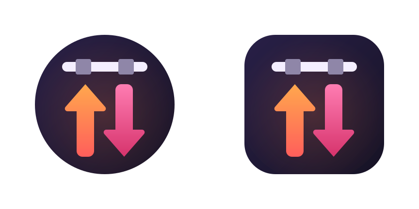

<p align="center"></p>

# pupdr

A Kotlin / Jetpack Compose Android app for tracking daily gym workouts. The name comes from the STM32 GPIO pull-up/pull-down register (PUPDR); the icon is a pull-up bar over ⇅ arrows.

## Features

- **870+ exercise library, offline.** The full [free-exercise-db](https://github.com/yuhonas/free-exercise-db) (public domain) is bundled. Search it, filter by muscle and equipment, and read step-by-step instructions. You can also add your own custom exercises.
- **Routines.** Build splits with target sets × reps and reorder them.
- **Import routines from almost anywhere**, as a file or pasted text. Everything is shown on a review screen first, so you can fix any match before saving. Supported:
  - set/rep schemes like `4x8`, `4 sets of 8`, `8 reps x 4 sets`, `3 x 10-12`, `3x30s`, `20 min`, `3 x AMRAP`, `5/5/5`, `12-10-8`
  - extra details like weights, RPE, rest, tempo and "each arm", which are stripped from the name
  - bullets, numbering, checkboxes, emoji, and superset labels like `A1.`
  - headers such as `# Push`, `Day 1 - Chest`, `Monday`, `PULL`, `**Upper body**`, `Legs:`, `Back and biceps`
  - several exercises on one line (`Day 1: Bench 3x8, Squat 5x5`)
  - vertical `Sets: 4 / Reps: 8` blocks
  - markdown, CSV and tab-separated tables, with or without a header row
  - JSON from other apps (any of the usual key names)
  
  Names are fuzzy-matched to the library and gym slang is understood (OHP, RDL, DB, lat pulldown, skull crushers…). Anything that doesn't match becomes a custom exercise.
- **Daily tracking.** Start a routine or add exercises one at a time, log weight and reps per set, and tick sets as done. New sets are pre-filled with the weight you used last time. You can move to any date. The app also shows your streak and how many sessions you did in the last 7 days.
- **Reports.** Pick Day, Week, Month, Year or All, step back through earlier periods, or choose a custom range. Each report shows:
  - days trained, sets, reps and volume
  - a per-day chart
  - sets per muscle
  - per-exercise best weight and estimated 1RM
  
  **Export** a report as CSV or a readable text summary, using the share sheet or saving it to your device.
- **Material 3 design**: Material You wallpaper colours (with a brand fallback), large collapsing app bars, a swipeable week strip, swipe-to-delete sets, and bottom-sheet menus.
- **Motion** follows Material's emphasized easing: fade-through between tabs, shared-axis for detail screens, animated list insert/remove/reorder, rolling numbers, growing charts, and FABs that collapse on scroll.
- kg / lb, light and dark themes, and an adaptive launcher icon that supports Android 13+ themed icons.

## Build

Requirements: JDK 17 and the Android SDK (compileSdk 37).

```
./gradlew assembleDebug        # app/build/outputs/apk/debug/app-debug.apk
./gradlew testDebugUnitTest
```

`gradle.properties` caps build memory: a 1.5 GB Gradle heap, 2 workers, and the Kotlin compiler running in-process. Test JVMs are capped at 768 MB, one fork at a time. To put a hard limit on the whole build:

```
systemd-run --user --scope -p MemoryMax=3G ./gradlew assembleDebug
```
